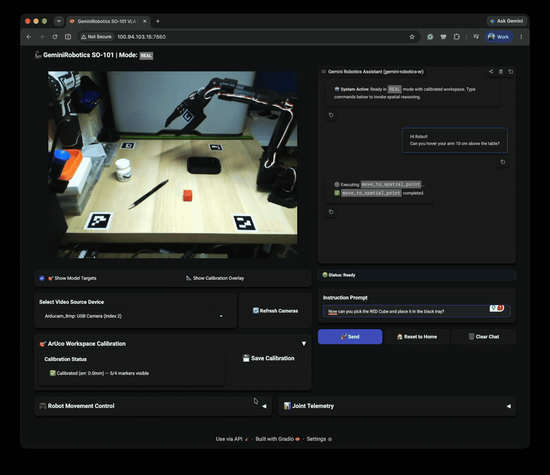
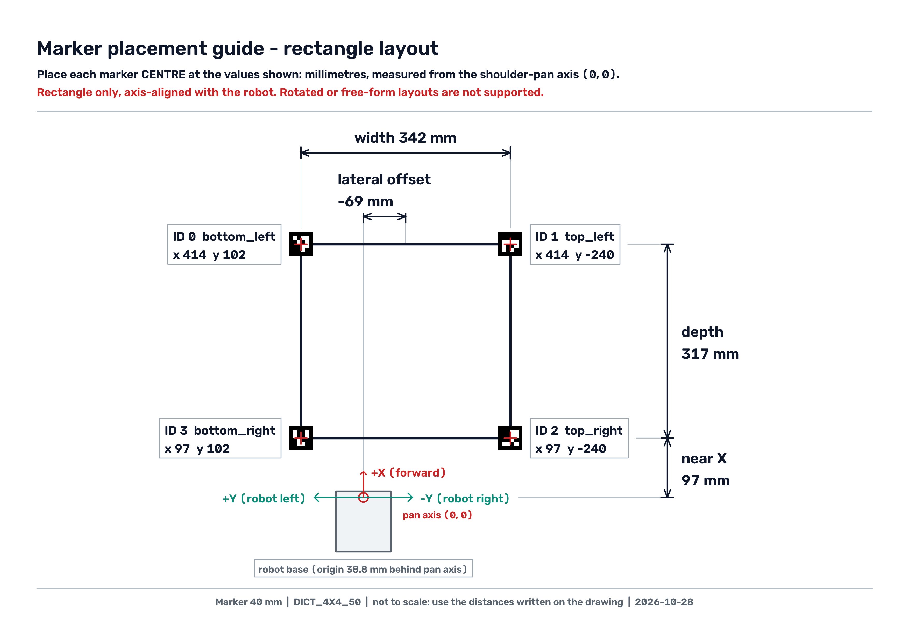

GeminiRobotics-SO101 connects [Google's Gemini Robotics multimodal models](https://ai.google.dev/gemini-api/docs/robotics-overview) (`gemini-robotics-er-2-streaming-preview`) to the low-cost 6-DOF [SO-101 robotic arm](https://huggingface.co/docs/lerobot/en/so101) via a unified web interface built with FastAPI, Gradio 6.0, OpenCV, and Three.js.

The user enters natural language instructions, and Gemini orchestrates pick-and-place tasks through continuous video streaming and real-time tool calling in both physical hardware and MuJoCo simulation.

<p align="center">
  
</p>

## Quick start

Try it in simulation first: no arm, camera, or calibration needed. You only need Python 3.13, [`uv`](https://docs.astral.sh/uv/), and a `GOOGLE_API_KEY` from [Google AI Studio](https://aistudio.google.com/).

1) Clone the repo:

   ```bash
   git clone https://github.com/Ekumen-OS/GeminiRobotics-SO101.git
   cd GeminiRobotics-SO101

   uv sync --extra ui
   source .venv/bin/activate
   ```

2) Setup your API Key in the `.env` file.

   ```bash
   cp .env.example .env              # then set GOOGLE_API_KEY in .env
   ```

3) Run the server in simulation `sim` mode.

   ```bash
   uv run python main.py --mode sim  # opens http://localhost:7860/
   ```

Open <http://localhost:7860/>, type an instruction such as *"pick up the cube and place it on the left"*, and watch Gemini drive the simulated arm.

For the physical SO-101, see [Hardware](#hardware), [Workspace Calibration](#workspace-calibration), and [Safety](#safety) before running `--mode real`.

## Table of contents

- [Quick start](#quick-start)
- [Table of contents](#table-of-contents)
- [Hardware](#hardware)
- [Installation](#installation)
- [Configuration](#configuration)
- [Workspace Calibration](#workspace-calibration)
- [Preflight Diagnostics](#preflight-diagnostics)
- [Safety](#safety)
- [Running the Server](#running-the-server)
- [Model Tools](#model-tools)
- [Troubleshooting](#troubleshooting)
- [Agent Skills](#agent-skills)
- [Development](#development)
- [Credits](#credits)

## Hardware

- **Arm**: Feetech STS3215-based SO-101 6-DOF robotic arm.
- **Camera**: 8MP Arducam  mounted ~45–60 cm above the tabletop looking down at the workspace.
- **Tabletop Mat**: Printable 4-corner ArUco calibration mat (`DICT_4X4_50`, IDs 1, 2, 3, 0).
- **Jaw Tag**: 25 mm ArUco marker (`DICT_4X4_50`, ID 10) mounted on the gripper fixed jaw for parallax-free visual closed-loop alignment.

## Installation

The project uses Python 3.13 and [`uv`](https://docs.astral.sh/uv/) for deterministic environment management:

```bash
git clone https://github.com/Ekumen-OS/GeminiRobotics-SO101.git
cd GeminiRobotics-SO101

# Simulation only (MuJoCo + Web UI)
uv sync --extra ui

# Real hardware (adds LeRobot and serial drivers)
uv sync --extra hw --extra ui

source .venv/bin/activate
```

## Configuration

Copy `.env.example` to `.env`.
In order to send request to the `Gemini Robotics 2 ER` model, you must adquire an API Key from [Google AI Studio](https://aistudio.google.com/).
Only `GOOGLE_API_KEY` (or Vertex AI credentials) is required to run:

```bash
cp .env.example .env
```

All runtime settings (serial port, table surface height, camera selection, stream quality, and grasp margins) are documented directly in [`.env.example`](.env.example).

## Workspace Calibration

Before the arm can pick things up, Gemini needs to know where the table is. Calibration teaches the system how to turn a point in the camera image (`[y, x]`, each from 0 to 1000) into a real position in millimetres from the robot's base.

It does this with four printed ArUco markers on the table corners, which the camera uses to work out the table's position and orientation (a perspective homography).

You only need to do this for the real arm. Simulation comes pre-calibrated. The steps below take about 15 minutes, plus print time.

1. **Describe your table with the setup wizard (`--setup`)**:
   Lay out the four corner markers as a **rectangle**, lined up with the robot: $+X$ points forward from the arm in its `HOME` pose and $+Y$ points to the robot's left. Free-form or rotated layouts aren't supported.

   ```bash
   uv run python main.py --setup
   ```

   The wizard will ask you for a few measurements in mm. Measure from the **shoulder-pan rotation axis** (the vertical axis at the base of the arm) to the marker centres:
   - **near X**: how far forward the closest pair of markers is from the pan axis;
   - **depth**: the distance from the near pair to the far pair;
   - **width**: the distance from the right pair to the left pair;
   - **lateral offset**: how far the rectangle's centre line sits to the side ($0$ = centred on the robot, negative = to the robot's right);
   - **marker size**.

   From your answers, the wizard saves the corner coordinates to `config/workspace_calibration.json`. The robot's base frame origin sits $38.8$ mm behind the pan axis (read from the SO-101 MuJoCo model, `simulation/assets/so101.xml`), so the wizard adds that $+38.8$ mm to your X measurements for you. You only ever measure from the pan axis.

   It also checks whether the arm can hover over the whole rectangle. Don't worry if some markers are out of reach: that's fine, because only the camera needs to see them.

   Finally, it creates everything you need to print:
   - An A4 placement guide (`assets/aruco_markers/workspace_placement_guide.png`).
   - The marker tiles (`marker_{0..3,10}.png`).
   - And `jaw_tag_sheet.png`.
  
   Re-run it with `--reuse` to change dimensions without regenerating the files, `--regenerate` to overwrite them, or `--non-interactive` to accept the defaults.

   Here is an example guide, generated for our own table (near X 97 mm, depth 317 mm, width 342 mm, lateral offset −69 mm). Yours will show your own measurements, so print the one the wizard writes, not this one. Click the image to open it full size.

   [](assets/docs/placement_guide.png)

   Once the markers are in place, check your work: start the Web UI (`uv run python main.py`) and turn on "📐 Show Calibration Overlay" (`ui/components/vision.py`).

   The overlay should line up with the table in the live camera stream.
   You can also compare the `height_mm` value in the `[Calibration] [CAMERA]` log with how high your camera actually is.

2. **(Optional) 3D-print the tags with `tools/aruco_stl.py`**:
   If you'd rather print rigid tags than paper, this tool generates watertight binary STL meshes for single-color grooved printing, or for dual-color printing in Bambu Studio / AMS (`_white.stl` + `_black.stl`):

   ```bash
   uv run python -m tools.aruco_stl --help
   ```

   Key CLI options:
   - `--marker-id`: Marker ID (default: 10 for jaw tag).
   - `--marker-size`: Active marker square side in mm (default: 19.5312 for a 25.0 mm outer tile).
   - `--margin`: Quiet-zone border per side in mm (default: 2.73438 -> 25.0 mm total outer tile).
   - `--thickness`: Total tile thickness in mm (default: 1.5).
   - `--groove-depth`: Recess depth in mm (default: 0.6 = 3 layers at 0.2 mm).
   - `--dictionary`: OpenCV dictionary (default: `DICT_4X4_50`).
   - `--all-workspace-markers`: Also generates 40 mm table corner tags (IDs 0, 1, 2, 3).

3. **Attach the jaw tag**:
   The jaw tag lets the camera see exactly where the gripper is. Stick the 25 × 25 × 1.5 mm ID 10 tile (white border included) flat on the camera-facing side of the fixed-jaw housing. Place it `80 mm` from the fixed fingertip line along the jaw toward the wrist, and `9.5 mm` from the fixed fingertip across the jaw toward the moving jaw. The default offset is `GRIPPER_TAG_LOCAL_OFFSET_MM=-25.4,25.5,78.6` (tag centre minus grasp site, in gripper coordinates). We tuned this value on a real gripper, where a caliper estimate turned out to be 12 mm off along the jaw axis, so adjust it if your tag sits elsewhere.

4. **Save the calibration**:
   In the Web UI, open the **ArUco Workspace Calibration** accordion. When all 4 corner markers are detected, click **💾 Save Calibration**.

5. **Calibrate the grasp on the real arm**:
   This teaches the system what "closed on nothing" and "closed on an object" look like.
   - Run `close_gripper` with nothing in the jaws. Note the logged aperture $A_{\text{empty}}$ (e.g. $-74.5^\circ$) and set `GRIPPER_EMPTY_APERTURE_DEG` to it.
   - Run `close_gripper` on a 30 mm cube. Note the aperture where the jaws stall, $A_{\text{object}}$, and set `GRASP_EMPTY_MARGIN_DEG` to about $0.40 \times (A_{\text{object}} - A_{\text{empty}})$.

## Preflight Diagnostics

Before starting the server, run the non-moving preflight check to verify dependencies, credentials, configs, port availability, and hardware access:

```bash
# Verify simulation environment (MuJoCo scene, IK solver, headless offscreen render)
uv run python main.py --mode sim --task check_environment

# Verify real hardware (serial bus permissions, motor calibration, camera capture)
uv run python main.py --mode real --task check_environment
```

Each check outputs `[OK]`, `[WARN]`, or `[FAIL]` with fix hints. Exits 0 on success, 1 on failure.

## Safety

- Keep a hand near the power switch, and run the first runs at low speed with a clear workspace.
- The model chooses targets autonomously.
- This project is a research demo, not a safety-rated controller.

## Running the Server

Launch the Unified FastAPI + Gradio Web UI at `http://localhost:7860/`:

```bash
# Simulation mode (MuJoCo physics + Three.js browser viewer)
uv run python main.py --mode sim

# Real robot mode (physical arm + live UVC camera MJPEG feed)
uv run python main.py --mode real

# Override serial port explicitly (defaults to ROBOT_PORT from .env)
uv run python main.py --mode real --port /dev/ttyACM0
```

The interface features live MJPEG camera streaming (`/api/stream`), conversational prompt execution with Gemini Live, manual joint and Cartesian jog controls, and an interactive 3D Three.js digital twin synchronized to arm telemetry at 30 Hz.

## Model Tools

Gemini Live calls these 6 primitives (defined in [`agent/tools.py`](agent/tools.py)):

| Tool | Parameters | Description |
|---|---|---|
| `move_to_spatial_point` | `point: [y, x]`, `z_height_cm: float = 3.0` | Move gripper to image coordinate $[0, 1000]$ at table height $z$. |
| `open_gripper` | *(none)* | Open gripper jaws fully. |
| `close_gripper` | *(none)* | Close jaws to grasp; returns aperture and grasp classification. |
| `move_to_preset` | `pose_name: str` | Move arm to named keyframe (`HOME` or `OBSERVE`). |
| `move_to_pose` | `qpos: [deg, ...]`, `duration_sec: float` | Interpolate arm joints directly to target angles. |
| `get_joint_positions` | *(none)* | Query current arm joint angles in degrees. |

## Troubleshooting

- **Serial device permissions (Linux)**: Ensure read/write access to `/dev/ttyACM0`:

  ```bash
  sudo chmod 666 /dev/ttyACM0            # Immediate temporary fix
  sudo usermod -a -G dialout $USER       # Permanent fix (requires re-login)
  ```

- **Camera busy / V4L2 device locks**: Ensure no other application (Zoom, OBS, browser) is using the USB camera index configured in `CAMERA_INDEX`. List attached video devices with `v4l2-ctl --list-devices`.
- **Headless rendering (Linux / SSH)**: MuJoCo uses EGL for offscreen rendering when `DISPLAY` is unset. Ensure NVIDIA/EGL drivers are present.
- **"Workspace is not calibrated"**: Place the 4-corner calibration mat in camera view, check `/api/stream`, and click **💾 Save Calibration** in the UI accordion.

## Agent Skills

We packaged what we learned building this project as three [Agent Skills](https://agentskills.io) in [GeminiRobotics-Skills](https://github.com/johannstark/GeminiRobotics-Skills). They teach coding agents (Claude Code, Antigravity, and others) to work with the same stack:

| Skill | Use it for |
|---|---|
| `gemini-robotics-er` | Gemini Robotics-ER 2 via the Interactions and Live APIs: pointing, bounding boxes, trajectories, task orchestration with tool calling, and real-camera grounding. |
| `mujoco-physics` | MuJoCo in Python or WASM: loading robot models, IK, gripper control, and pick-and-place. |
| `threejs-rendering` | Three.js viewers for MuJoCo scenes: pose sync, perception snapshots, and streaming from Python. |

To install them, clone the skills repo and run its installer:

```bash
git clone https://github.com/johannstark/GeminiRobotics-Skills.git ~/code/GeminiRobotics-Skills
cd ~/code/GeminiRobotics-Skills
```

And now, pick one of the following:

```bash
./install.sh ~/code/GeminiRobotics-SO101   # this project only (symlinks into .claude/skills and .agents/skills)
./install.sh --global                      # every project (~/.claude/skills and ~/.gemini/config/skills)
./install.sh --copy <project>              # copy instead of symlink (Windows, containers)
```

Restart your agent session afterwards. Symlinks point back to your clone, so `git pull` updates the skills.
See the [skills README](https://github.com/johannstark/GeminiRobotics-Skills#install) for Antigravity CLI paths and how to invoke each skill.

## Development

```bash
# Install all development extras and pre-commit hooks
uv sync --all-extras
uv run pre-commit install

# Run unit and integration tests
uv run pytest tests/ -v

# Run physics-heavy slow tests (seeded MuJoCo pick-and-place harness)
uv run pytest -m slow -s

# Code formatting, linting, type-checking, and import contracts
uv run ruff check --fix .
uv run ruff format .
uv run mypy
uv run lint-imports
```

See [ARCHITECTURE.md](ARCHITECTURE.md) for data flows, subsystem interfaces, and invariants, and [AGENTS.md](AGENTS.md) for coding guidelines.

Contributions are welcome — see [CONTRIBUTING.md](CONTRIBUTING.md) for setup, checks, and pull request workflow.

## Credits

- **SO-101 Hardware & Simulation Model**: [TheRobotStudio / SO-ARM100](https://github.com/TheRobotStudio/SO-ARM100) (Apache-2.0) and [Hugging Face LeRobot](https://huggingface.co/docs/lerobot/en/so101) — see [`simulation/assets/README.md`](simulation/assets/README.md) and [`NOTICE`](NOTICE).
- **Physics Simulation**: [MuJoCo](https://github.com/google-deepmind/mujoco) by Google DeepMind.
- **Embodied Reasoning**: [Google Gemini Robotics](https://ai.google.dev/gemini-api/docs/robotics-overview) (`gemini-robotics-er-2-streaming-preview`).

***

Made in Colombia 🇨🇴 with Love ❤️.
