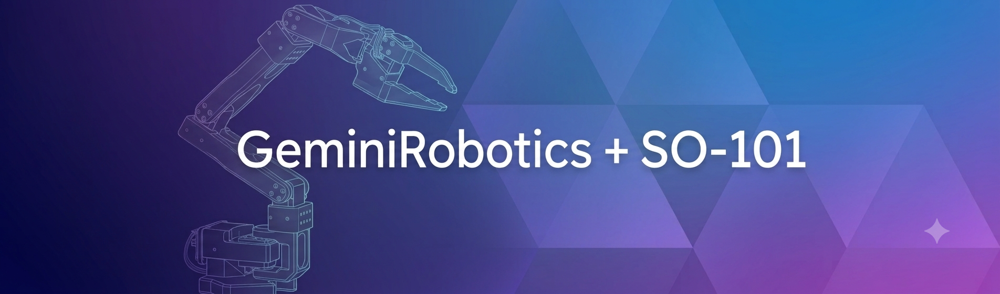
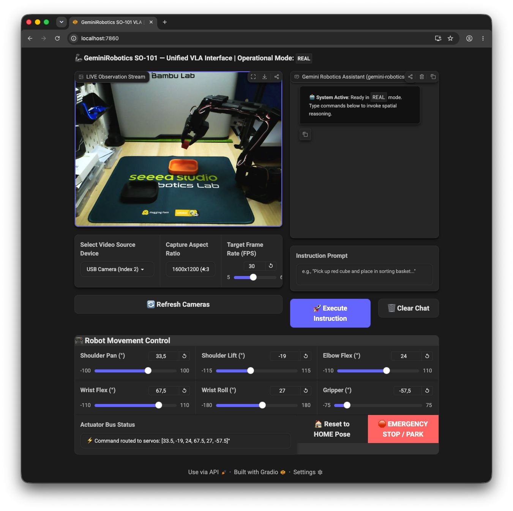

# 

## Welcome to **GeminiRobotics-SO101** 🤖

This repository combines Google's Gemini Robotics AI models (`gemini-robotics-er`) and capabilities with the **SO-101 Robotic Arm** setup.

At the core of our user experience is a unified **FastAPI + Gradio 6.0 Web VLA Interface** powered by OpenCV and Three.js.

This interactive web application serves as the unified dashboard for physical hardware manipulation, real-time video observation streaming, interactive 3D WebAssembly simulation viewing, degree-tuned actuator adjustments, and live multimodal action execution via the **Gemini Live API**!

<p align="center">
  
</p>

We use Python version **3.13.7** and the extremely fast, deterministic package manager `uv` for managing all environments and dependencies.

> [!IMPORTANT]
> This repo is actively under development as we integrate intelligent robotics behaviors and VLA trajectory inference driven by Gemini Robotics!

## Architecture & Modules

The repository strictly enforces a layered dependency architecture (`robot < simulation < vision < agent < ui`, with operator tooling in `tools/` importing layers below it):

1. **[`/robot`](robot/) (Core Robot Definition, Kinematics & Registry)**
   - **Constants & Poses**: Definitional parameters, joint names, hardware limits, and standard target postures ([`constants.py`](robot/constants.py)).
   - **Kinematics & Theory**: Forward kinematics ([`kinematics.py`](robot/kinematics.py)), numerical damped least-squares Inverse Kinematics with null-space projection ([`cartesian_ik.py`](robot/cartesian_ik.py)), and mathematical theoretical foundations ([`theory.md`](robot/theory.md)).
   - **Workspace Calibration**: ArUco fiducial detection, perspective homography mapping, and dual real/sim homography persistence ([`calibration.py`](robot/calibration.py), [`config/workspace_calibration.json`](config/workspace_calibration.json)).
   - **Programmatic Perception**: OpenCV visual alignment offset engine and post-lift grasp verification ([`perception.py`](robot/perception.py), [`vision_detector.py`](robot/vision_detector.py)).
   - **Hardware Driver**: Physical serial bus interface for Feetech servos ([`real_robot.py`](robot/real_robot.py)) adhering to [`RobotInterface`](robot/interface.py).
   - **Active Robot Registry**: Thread-safe global active-robot registry ([`registry.py`](robot/registry.py)).

2. **[`/simulation`](simulation/) (MuJoCo Physics & Environments)**
   - **Physics Simulation**: High-level MuJoCo model manipulation ([`sim_robot.py`](simulation/sim_robot.py)), fixed workspace camera (`workspace_cam`), ArUco corner fiducials, centered 3D STL meshes, and passive 3D interactive rendering ([`simulate.py`](simulation/simulate.py)).
   - **Synthetic Workspace Calibration**: Analytical pinhole camera projection and exact geometric homography computation ([`sim_calibration.py`](simulation/sim_calibration.py), [`config/workspace_homography_sim.npz`](config/workspace_homography_sim.npz)).
   - **Reinforcement Learning & Warp**: Gymnasium reach target environments ([`env.py`](simulation/env.py)) and hardware-accelerated batched simulations using NVIDIA Warp ([`warp_env.py`](simulation/warp_env.py)).
   - **Validation & Test Suites**: Diagnostic verifiers including linear Cartesian sweeps ([`test_movement.py`](simulation/test_movement.py)) and system health checks ([`check_env.py`](simulation/check_env.py)).

3. **[`/vision`](vision/) (Camera Capture, Dual Buffers & Sim Runtime)**
   - **Camera Driver & Enumeration**: V4L2 device capability querying and camera discovery ([`camera.py`](vision/camera.py)).
   - **Shared Capture Manager**: Multi-consumer shared capture thread and video stream production ([`capture.py`](vision/capture.py)).
   - **Dual Frame Buffer Engine**: Separation between untouched raw model observations (`get_latest_raw_jpeg`) and operator annotated display frames (`get_latest_jpeg`) ([`frames.py`](vision/frames.py)).
   - **Calibrator Registry & Blackboard**: Mode-aware workspace calibrator caching ([`calibrator.py`](vision/calibrator.py)) and model-target blackboard with sleek corner-notched bounding box overlays ([`targets.py`](vision/targets.py)).
   - **Simulation Frame Runtime**: Dedicated background sim rendering worker ([`sim_runtime.py`](vision/sim_runtime.py)).

4. **[`/agent`](agent/) (Gemini Live API & VLA Controller)**
   - **Live WebSocket Session**: Real-time bidirectional streaming session manager (`GeminiLiveSession` in [`live_session.py`](agent/live_session.py)) supporting Google AI Studio and Vertex AI credentials.
   - **Robot Tooling & Execution**: Tool declarations (`ROBOT_TOOL_DECLARATIONS`) and execution adapters (`execute_tool_call` in [`tools.py`](agent/tools.py)) supporting smooth pose interpolation, direct joint control, gripper actuation, named preset poses, and calibrated spatial pointing with vertical offset control.
   - **VLA Controller & Verification Loop**: Asynchronous controller (`VLAController` in [`vla_controller.py`](agent/vla_controller.py)) enforcing a strict **"Move -> Look -> Correct"** visual verification loop, post-action camera frame observation injection with 0.3s vision settling delays, continuous video frame ingestion (~1 FPS), enriched orchestration prompt guidance, spatial grounding for real & sim modes, and emergency stop handling.
   - **Verbose Diagnostic Terminal Logging**: ISO-8601 millisecond-precision diagnostic logging (`[YYYY-MM-DD HH:MM:SS.mmm] [MODULE] [TAG] message`) routing model decisions, tool call payloads (`call.args`), and execution results (`result_dict`) to stdout/stderr while keeping Chat UI reasoning clean.

5. **[`/tools`](tools/) (Operator Tooling & Wizards)**
   - **Printable Calibration Sheets**: True-to-scale workspace calibration mat poster and ArUco marker PNG generator ([`calibration_sheet.py`](tools/calibration_sheet.py)).
   - **Interactive Setup Wizard**: Terminal CLI wizard configuring table dimensions, clearances, and marker reuse ([`setup_wizard.py`](tools/setup_wizard.py)).

6. **[`/ui`](ui/) (Unified Web VLA Interface & 3D Viewer)**
   - **FastAPI + Gradio Server**: Unified web server mounting static simulation assets (`/sim_assets`, `/ui_assets`), dynamic simulation state endpoint (`/api/sim_state`), `/api/stream` and `/api/sim_stream` MJPEG endpoints, and Gradio 6.0 Blocks layout with TehnoX dark theme ([`app.py`](ui/app.py)).
   - **Interactive 3D Simulation Viewer**: Embedded Three.js WebAssembly 3D viewer ([`assets/sim_viewer.html`](ui/assets/sim_viewer.html)) rendering real-time kinematics and centered mesh poses in `sim` mode.
   - **Lazy Kinematics State Management**: Centralized robot state manager and lazy kinematics transforms ([`state.py`](ui/state.py)).
   - **Multimodal Chat & Dynamic UI Blocking**: Real-time conversational AI interface with full input blocking during active model turns, dynamic status banner (`🟢 Status: Ready` / `⏳ Status: Working...`) ([`components/chat.py`](ui/components/chat.py)), and degree-tuned servo control sliders ([`components/controls.py`](ui/components/controls.py)).

## Getting Started

### Requirements

- Python 3.13.7
- `uv` package manager ([Installation Guide](https://docs.astral.sh/uv/getting-started/installation/))
- Clone this repository:

```bash
git clone https://github.com/Ekumen-OS/GeminiRobotics-SO101.git
cd GeminiRobotics-SO101
```

- Setup the repository environment and install dependencies:

```bash
uv sync
source .venv/bin/activate
```

### Environment Configuration (`.env`)

To enable Gemini Live API features and multimodal chat, configure your API credentials by copying `.env.example`:

```bash
cp .env.example .env
```

Edit `.env` with your preferred authentication method:

```bash
# Option A: Google AI Studio API Key (Recommended)
GOOGLE_API_KEY=your_google_ai_studio_api_key_here

# Option B: Google Cloud Vertex AI
# GOOGLE_CLOUD_PROJECT=your_project_id
# GOOGLE_CLOUD_LOCATION=us-central1

# Physical SO-101 Serial Port (optional, defaults to /dev/tty.usbmodem5B415332861)
# ROBOT_PORT=/dev/ttyACM0

# Grasp Sensing & Verification (Phase 3a)
# GRIPPER_EMPTY_APERTURE_DEG=-74.5
# GRASP_EMPTY_MARGIN_DEG=6.0
# GRIPPER_SETTLE_S=0.6
# GRASP_LOAD_MIN=20.0
```

- If using physical hardware, use the LeRobot package to find the serial port of your SO-101 robotic arm and calibrate it ([LeRobot SO-101 Guide](https://huggingface.co/docs/lerobot/so101)).
- You are now ready to launch the Web UI and control your robot!

### Configuration Settings Reference

| Environment Variable | Default | Description |
| :--- | :--- | :--- |
| `GRIPPER_EMPTY_APERTURE_DEG` | `-75.0` | Aperture the gripper servo reports when closed on nothing. Set from step 1 of the checklist below; the arm's calibration decides this value, not the model. |
| `GRASP_EMPTY_MARGIN_DEG` | `6.0` | Margin in degrees above the empty aperture to classify as `closed_on_air` (threshold = empty aperture + margin). |
| `GRIPPER_SETTLE_S` | `0.6` | Stabilization settling delay in seconds after gripper motion before querying servo registers. |
| `GRASP_LOAD_MIN` | *unset* | Minimum motor load threshold required to verify grasp (optional secondary guardrail). |
| `DESCENT_GATE` | `block` (sim) / `warn` (real) | Gate policy for vertical descent: `block` (reject unaligned), `warn` (log warning), or `off`. |
| `ALIGNMENT_TOLERANCE_MM` | `4.0` | Jaw-to-target distance (robot mm, table plane) under which a hover counts as aligned (`is_aligned`) and a descent is allowed. |
| `GRIPPER_TAG_LOCAL_OFFSET_MM` | `-7,27,63` | Jaw-tag centre relative to the grasp site in the gripper frame, `x,y,z` in mm (see [Jaw tag](#jaw-tag)). The default is the simulated mount; measure it on the real arm. |
| `CAMERA_HFOV_DEG` | `70.0` | Nominal horizontal field of view of the workspace camera, used to recover the camera position from the table homography (a ±10 % error costs only a few mm). Check the logged `[Calibration] [CAMERA] centre_mm=[x, y, z]` against a tape measure. |
| `BIAS_CORRECTION` | `1` | Learn a per-target correction from jaw-tag residuals at the hover (`1`) or never correct (`0`, for A/B runs). |
| `GRIPPER_LOCATOR_ER2` | `0` | Ask ER2 to point at the fingertips (`1` or `0`). Report-only: the point appears as `perception.er2_gripper_point_1000` and never decides alignment. |
| `ER2_LOCATOR_MODEL` | `gemini-robotics-er-2-preview` | Model for that pointing query (`generate_content`; the streaming Live model does not serve it). |
| `VISION_SETTLE_S` | `0.3` | Camera stabilization settling delay in seconds before capturing post-action verification frames. |
| `ROBOT_PORT` / `SO101_PORT` | `/dev/tty.usbmodem...` | Serial device path for physical Feetech bus adapter. |
| `CAMERA_NAME` / `CAMERA_INDEX` | *auto* | Device substring or index for external camera selection. |
| `WEB_STREAM_FPS` | `15` | Frame rate for operator MJPEG stream. |
| `WEB_JPEG_QUALITY` | `75` | JPEG encoding quality for operator MJPEG stream. |

### Real-Arm Grasp Calibration Checklist

Follow this procedure when deploying to a physical SO-101 robotic arm. Steps 1–5 tune the grasp classifier; steps 6–9 mount the jaw tag and validate the closed loop. All values are read from the `[Tools] [...]` terminal log lines, not from the chat.

1. **Close on Air**: Execute `close_gripper` with no object between jaws. Inspect terminal log `[Tools] [GRASP] aperture=...` and record the fully closed aperture $A_{\text{empty}}$ (e.g., $-74.5^\circ$).
2. **Close on Object**: Place your standard target object (e.g., 30 mm calibration cube) between the jaws and execute `close_gripper`. Record the stalled aperture $A_{\text{object}}$ (e.g., $-34.5^\circ$).
3. **Calculate Gap**: Compute $\Delta A = A_{\text{object}} - A_{\text{empty}}$ (e.g., $-34.5^\circ - (-74.5^\circ) = 40.0^\circ$).
4. **Set Anchor and Margin**: In your `.env`, set `GRIPPER_EMPTY_APERTURE_DEG` to $A_{\text{empty}}$ and `GRASP_EMPTY_MARGIN_DEG` to approximately 40% of the gap:
   $$\text{GRASP\_EMPTY\_MARGIN\_DEG} \approx 0.40 \times \Delta A$$
   *(e.g., $A_{\text{empty}} = -74.5^\circ$, margin $= 0.40 \times 40.0^\circ = 16.0^\circ$, threshold $= -58.5^\circ$). Without the anchor the threshold is measured from $-75^\circ$, which is only correct if your calibration happens to close there.*
5. **Leave `GRASP_LOAD_MIN` unset** until you have read a few `load=` values from the log: the STS3215 `Present_Load` register is raw sign-magnitude (bit 10 is direction), so a reverse-direction load reads above 1023.
6. **Mount the Jaw Tag**: Print the jaw-tag page (`uv run python main.py --task generate_markers`): ArUco `DICT_4X4_50`, **ID 10**, **25 mm** (smaller tags are detected in only a fraction of poses at 640×480), matte, and mount it as described in [Jaw tag](#jaw-tag). Hover 5 cm over the mat centre and each corner; the tag must be detected in all five places (watch `/api/stream`).
7. **Measure the Tag Offset and Check the Camera**: Measure the tag-centre-to-grasp-site offset with a ruler in the gripper frame and set `GRIPPER_TAG_LOCAL_OFFSET_MM=<x>,<y>,<z>`. Set `CAMERA_HFOV_DEG` from the camera's datasheet and compare the logged camera centre (`[Calibration] [CAMERA] centre_mm=...`) with a tape measure (height above the mat above all). Until the tag is mounted the locator falls back to forward kinematics (`gripper_source="kinematic"`, `is_aligned=null`).
8. **Validate with `DESCENT_GATE=warn`** (the real-mode default): run five picks of the cube from different spots. Expect `gripper_source="aruco"`, a measured offset `measured_offset` (`dx_mm`, `dy_mm`) that falls to within `ALIGNMENT_TOLERANCE_MM` after the second hover, a non-zero `applied_correction_mm` on that second hover and the descent, and a `grasp_verification` that matches what you see every time. Search the log for `convergence timeout`: it means the servos did not reach the commanded pose within 2 s, so measurements may be taken too early.
9. **Switch to `DESCENT_GATE=block`**: a deliberately misaligned descent must now be refused with `error_type="descent_gate"` instead of executed.

### Jaw tag

The closed loop measures where the gripper really is with one ArUco tag on the gripper, compared with the target in robot millimetres (see `vision/gripper_locator.py`).

- **Tag**: `DICT_4X4_50`, **ID 10**, **25 mm** square, matte, flat (`uv run python main.py --task generate_markers` prints it at 1:1; verify the 50 mm scale line on the printout).
- **Where (simulation mount, a printable bracket on the real arm)**: on the flank of the gripper that faces the workspace camera, beside the round moving-jaw pivot horn and clear of both fingers: 27 mm out from the gripper centreline and 40 mm below the top of the servo block, i.e. about 63 mm above the fingertip level when the gripper points straight down. A tag on top of the housing was tried and is hidden behind the wrist servo for a camera at the side (0/12 detections); a tag next to the fingertips hides the cube (visible cube area 750 → 0–390 px²). The sim mount is detected in 12/12 poses at 640×480 and leaves ≥ 89 % of the cube visible at a 3 cm hover. A real mount depends on where *your* camera is: check the tag in `/api/stream` before trusting it.
- **Gripper frame for `GRIPPER_TAG_LOCAL_OFFSET_MM`** (measure with the gripper pointing down, jaws open; the offset is *tag centre minus grasp site*):
  - **origin**: the grasp site: the midpoint between the inner faces of the two finger pads when closed on a 30 mm object, at the level of the pads' lower edge (the fingertip level);
  - **x**: the jaw closing direction, from the fixed finger towards the moving jaw;
  - **y**: along the jaw hinge axis, towards the side that carries the moving-jaw pivot horn;
  - **z**: along the wrist-roll axis from the fingertips towards the wrist (up when the gripper points down).
- **Defaults**: `GRIPPER_TAG_LOCAL_OFFSET_MM=-7,27,63` (the simulated mount, 1.5 mm accurate against MuJoCo ground truth), `CAMERA_HFOV_DEG=70`, `ALIGNMENT_TOLERANCE_MM=4`.
- **Grasp site (TCP) note**: in `simulation/assets/so101.xml` the `gripperframe` site was moved from the URDF position (on the inner face of the *fixed finger*, x = −7.9 mm, z = −98.1 mm in the gripper frame) to the pad midpoint (x = +7 mm, z = −103 mm): with the URDF site an IK target at an object's centre puts the fixed finger inside the object. The IK solver reads the same file in real mode, so a real arm now also reaches the object with the *middle of the jaws*, not the fixed finger. The simulated pads leave 5 mm of clearance to a 30 mm cube on the fixed side; closing slides the cube against the fixed pad.

## Running the Robot (`main.py`)

[`main.py`](main.py) is the unified entry point for running the SO-101 robotic arm in physical control, MuJoCo simulation, or automated verification. By default, running `main.py` launches the modern **FastAPI + Gradio VLA Web UI Server** on port `7860`:

```bash
# Instantly launch the Unified VLA Web UI server (default mode is 'real')
# Open your browser at http://localhost:7860/
uv run python main.py

# Launch Web UI specifying an explicit physical serial port (or set ROBOT_PORT in .env)
uv run python main.py --mode real --port /dev/ttyACM0

# Launch Web UI with interactive 3D simulation viewer
# (the former 'twin' split view was removed; only 'real' and 'sim' are supported)
uv run python main.py --mode sim

# Development auto-reload (restarts server when Python files change)
uv run python main.py --mode sim --reload
```

> [!NOTE]
> The `--port` argument defaults to the value set in `ROBOT_PORT` (or `SO101_PORT`) in your `.env` file, falling back to `/dev/tty.usbmodem5B415332861`. If your serial adapter differs, configure `ROBOT_PORT` in `.env` or pass `--port <path>` (e.g., `/dev/ttyACM0` on Linux or `/dev/tty.usbmodem...` on macOS).
>
> **Linux Serial Permissions**: On Linux, ensure your user has read/write permissions for the serial port device (e.g., `/dev/ttyACM0`). You can grant immediate access with `sudo chmod 666 /dev/ttyACM0` or permanent access with `sudo usermod -a -G dialout $USER` (requires logout or `newgrp dialout`). You can run `uv run python main.py --task check_environment` to verify port access.

## Gemini Live API & Robot Tool Capabilities

When interacting with the AI in the Web UI chat or via the agent controller, Gemini has access to real-time function calling tools (defined and mirrored from the single-source-of-truth `TOOL_REGISTRY` in [`agent/tools.py`](agent/tools.py)):

| Tool Name | Description | Parameters |
| :--- | :--- | :--- |
| `send_message` | Speak, narrate observations, explain planned steps, or confirm completion. | `message` (string) |
| `move_to_pose` | Smoothly interpolate arm to 6-DOF joint target in degrees. | `qpos` (array of 6 degs), `duration_sec` |
| `set_joint_positions` | Instant snap joint position command in degrees. | `qpos` (array of 6 degs) |
| `open_gripper` | Fully open the gripper end-effector. | None |
| `close_gripper` | Close the gripper end-effector. | None |
| `move_to_preset` | Move arm to named keyframe (`HOME`, `MIDDLE`, `SWEEP_HOME`). | `pose_name` (string) |
| `move_to_spatial_point` | Ground 2D image coordinates $[y, x] \in [0, 1000]$ into 3D Cartesian coordinates via ArUco calibration and solve IK at target $z$ height. | `point` (array of 2 numbers), `z_height_cm` (optional, default: 3.0) |
| `get_joint_positions` | Read current joint angles in degrees. | None |
| `get_end_effector_pose` | Read 3D Cartesian position and orientation matrix (sim). | None |

## Model-Driven Closed-Loop Orchestration & Workspace Calibration

### 1. ArUco Workspace Calibration & Sheet Generator (`robot/calibration.py`)

- Detects 4-corner ArUco fiducials (`DICT_4X4_50`, canonical IDs: `1: Top-Left`, `2: Top-Right`, `3: Bottom-Right`, `0: Bottom-Left`) defining the physical workspace mat.
- Computes perspective homography mapping camera pixels directly to physical robot base millimeters with lateral $Y$-axis parity.
- Configurable via `config/workspace_calibration.json`. Full architecture details are in [`ARCHITECTURE.md`](ARCHITECTURE.md).
- **Interactive Setup Wizard & Marker / Sheet Generator**:

  ```bash
  # Launch interactive calibration wizard (auto-detects existing markers and asks whether to reuse or replace):
  uv run python main.py --task generate_markers

  # Reuse existing physical markers and update dimensions in JSON without regenerating files:
  uv run python main.py --task generate_markers --reuse

  # Force regeneration of marker PNGs and calibration mat sheet:
  uv run python main.py --task generate_markers --regenerate
  ```

  Features & Artifacts:
  - **Auto-Detection**: Automatically detects existing marker files in `assets/aruco_markers/` and prompts whether to reuse them or regenerate.
  - `assets/aruco_markers/workspace_calibration_sheet.png` — An all-in-one printable tabletop calibration mat with 4 corner markers, robot base alignment guide, workspace boundaries, and coordinate axes.
  - `assets/aruco_markers/marker_{0..3}.png` — Individual high-resolution marker stickers.

### 2. Model-as-Orchestrator Closed-Loop Architecture (`agent/vla_controller.py`)

- Powered by `gemini-robotics-er-2-streaming-preview` via the Gemini Live API bidirectional WebSocket session with thinking enabled (`include_thoughts=True`).
- **Continuous Visual Perception**: Ingests video frames at ~1 FPS both during motion execution and continuously in the background while the model reasons between tool calls.
- **Strict "Move -> Look -> Correct" Visual Verification Loop**:
  - Enforces a mandatory 3-phase cycle for spatial manipulation:
    1. **Move**: Move the arm/gripper towards approach hover altitude above the target object using `move_to_spatial_point`.
    2. **Look**: Model explicitly pauses and inspects the freshly settled post-action camera frame to understand the scene, then reads the *measured* alignment from the tool response (`perception.measured_offset` in mm, `is_aligned`, `applied_correction_mm`). The controller, not the model, measures the gripper (jaw tag, parallax removed) and never lets the model offset a point.
    3. **Correct**: If `is_aligned` is `false`, the model re-issues the same hover call; the controller applies the learned per-target correction and the next measurement should be within tolerance. Only an aligned hover may descend.
- **Programmatic Perception Feedback & Anti-Hallucination Guardrails (`robot/perception.py`)**:
  - Locks the target object once (footprint centre in robot mm), measures the jaw against it in the table plane (`dx_mm`, `dy_mm`, `distance_mm`, `is_aligned` within `ALIGNMENT_TOLERANCE_MM`) and returns the numbers in the tool payload.
  - Enforces strict controller gates: no descent without a measured, aligned hover at the same target; after the grasp only the lift (straight up) is allowed until the post-lift gripper sensor confirms the grasp (vision can only veto); transport then moves to a raw destination while the aperture is re-read after every move.
  - Automates a 3-attempt grasp retry loop per object with graceful escalation (also after 3 consecutive refusals or 4 hovers without a descent).
- **Post-Action Observation Frame Injection**: Injects a fresh settled camera frame (with a 0.3s physical stabilization delay) immediately after every blocking tool execution before returning `FunctionResponse`, providing ground-truth post-action state for immediate inspection and error correction.
- **UI Input Blocking & Dynamic Status Indication**: Prevents concurrent user input or race conditions during model turns. When an instruction is submitted, the prompt textbox, execution button, homing button, clear button, and randomize target button are disabled, and the banner transitions to `⏳ Status: Working...`. Once the model finishes its execution turn (or on exception), the UI is safely restored to `🟢 Status: Ready` via a robust `try...finally` block.
- **Verbose Timestamped Terminal Logging vs. Chatbot CoT**:
  - Maintains a clean separation between user-facing conversational narration and operator diagnostics.
  - High-level thoughts (`> 💭 *...*`) and responses stream cleanly to the Gradio Chatbot.
  - Low-level JSON tool call payloads (`call.args`), execution results (`result_dict`), WebSocket frame dispatches, and error traces are printed to `stdout`/`stderr` with ISO-8601 millisecond timestamps (`[YYYY-MM-DD HH:MM:SS.mmm] [MODULE] [TAG] message`).
- **Minimalist Multi-Target Bounding Box Overlay**: Renders clean, color-coded bounding boxes with corner accents and floating coordinate badges on the video stream showing all detected objects and where Gemini is focusing in real time.
- **Continuous Live ArUco Calibration**: Dynamically tracks visible fiducials and computes perspective homography continuously on the physical USB camera feed, eliminating camera perspective drift.
- **Direct Primitive Tool Calling**: Rather than relying on a rigid state machine, the model orchestrates multi-step actions (Hover $\rightarrow$ Look $\rightarrow$ Correct $\rightarrow$ Descend $\rightarrow$ Grasp $\rightarrow$ Retract $\rightarrow$ Transport $\rightarrow$ Release) by invoking tool primitives.

## Testing & Diagnostics

Verify system health, MuJoCo simulation physics, inverse kinematics, and unit test suites:

```bash
# 0. Install pre-commit hooks for automated code formatting and lint checks
uv run pre-commit install

# 1. Run complete automated unit test suite (Workspace Calibration, Tool Adapters, VLA Controller, UI)
uv run pytest tests/ -v

# 1b. Run the slow physics scenarios: scripted pick-and-place over 10 seeded cube placements in
#     MuJoCo (unbiased, and with a hidden 1.5 deg shoulder-pan encoder offset with/without the
#     corrector), judged against MuJoCo ground truth; prints the metrics table with -s
uv run pytest -m slow -s

# 2. Verify movement & kinematics via automated X, Y, and Z Cartesian line sweeps
uv run python main.py --task test_simulation

# 3. Check system diagnostics, dependency imports, and MuJoCo FPS throughput
uv run python main.py --task check_environment

# 4. Test Gemini Live API WebSocket session and tool calling (requires .env)
uv run python test_live.py
```

### Troubleshooting & Fail-Closed Diagnostics

- **`HardwareError: Could not connect to physical robot on port...`**:
  - Verify that the physical SO-101 arm is connected via USB and powered.
  - Check serial device permissions (on Linux, ensure the user belongs to the `dialout` group: `sudo usermod -a -G dialout $USER`).
  - When running in `--mode real` without hardware, the UI displays `⚠️ Hardware Offline. Arm not connected.` and manual sliders remain disabled. Spatial and joint movement tool calls fail closed with `error_type: "hardware"` rather than assuming target arrival.
- **`CalibrationUnavailable: Workspace is not calibrated...`**:
  - Real-world spatial grounding requires active ArUco fiducials. Generate printable markers (`uv run python main.py --task generate_markers`), place the sheet in the camera FOV, and save calibration via the UI.
- **`PerceptionUnavailable: Camera frame unavailable...`**:
  - In real mode, the camera stream fails closed if the capture feed stops or frame buffer empties. Check USB camera connection and ensure no other application is holding exclusive lock.
- **`HardwareError: Motion interrupted`**:
  - Raised when an in-progress arm trajectory is stopped mid-motion (e.g. operator interrupt,
    safety trigger, or shutdown). Surfaces as `error_type: "hardware"` with `robot_moved=True`
    whenever at least one step was written to motors, guaranteeing the model never assumes
    completed motion on an aborted action.

## Kinematics & Mathematics Reference

For a complete explanation of Denavit-Hartenberg (DH) parameters, transformation matrices, spatial Jacobians, and under-actuated 5-DOF damped least-squares Inverse Kinematics, consult our documentation:

- [SO-101 Robot Arm Kinematics Theory (`robot/theory.md`)](robot/theory.md)
- [Behind the Code: Engineering GeminiRobotics-SO101 (`behind_the_code.md`)](behind_the_code.md)

---

Made with ❤️ in Colombia 🇨🇴
